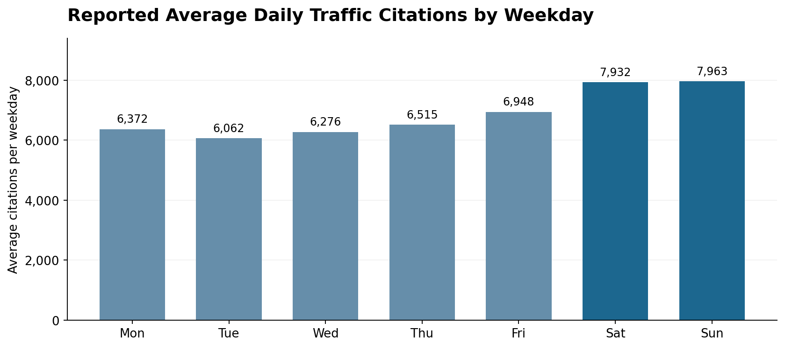
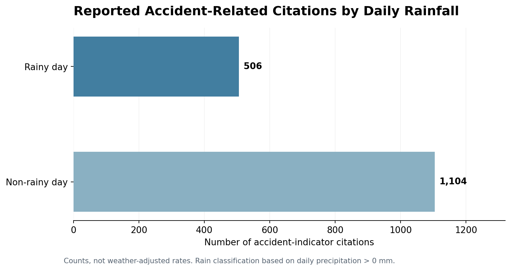

# DC Traffic Violations & Weather Analytics

**Python · Pandas · MySQL · SQLAlchemy · ETL · SQL**  

## Project overview

I developed a Python ETL pipeline that integrates Washington, DC moving-violation records with daily weather observations, loads the cleaned data into MySQL, and uses SQL to examine citation trends, speeding-related fines, and differences between rainy and non-rainy days.

**Project snapshot:** **2,475,473** unique violation records loaded in the original academic run. This is a historical result, **not** a live count.

## Key results from the original project

| Metric | Reported result |
|---|---:|
| Unique traffic violation records processed | **2,475,473** |
| Tickets issued since October 1, 2024 | **2,197,380** |
| Tickets on days with recorded precipitation | **363,055** |
| Accident-related tickets on rainy days | **506** |
| Accident-related tickets on non-rainy days | **1,104** |

### Average citations by weekday

The reported weekday query divides each weekday's ticket total by the number of distinct dates of that weekday in the violations table. Weekend averages were higher than Monday's in this historical snapshot.

### Accident-related citations on rainy vs. non-rainy days

This comparison shows **raw counts**, not a risk or rate comparison: the number of observed rainy and non-rainy dates may differ. A “rainy day” means the matched daily weather record has precipitation above zero, **not necessarily that rain was falling when the ticket was issued**.

## Data sources

| Dataset | Provider | Access / coverage |
|---|---|---|
| Moving Violations Issued | [DC Open Data](https://opendata.dc.gov/) | Monthly DC citation files; historical snapshots used for coursework |
| Daily weather | [Visual Crossing](https://www.visualcrossing.com/) | Daily temperature and precipitation; API key required |

The underlying bulk CSV files are **not included**. DC Open Data and Visual Crossing have separate terms for data reuse and redistribution; consult those terms before republishing raw records. Links above point to the providers rather than claiming a permanent exact dataset download URL.

## ETL workflow

`DC Open Data + Visual Crossing API → Python / Pandas → CSV staging → MySQL → SQL queries`

1. **Extract:** Fetch monthly citation CSV files and daily weather observations. Previously downloaded citation-month files are skipped; the weather downloader resumes from the last saved day.
2. **Transform:** Consolidate monthly files, remove duplicate `OBJECTID` records, and standardize date and numeric fields.
3. **Load:** Populate MySQL `violations` and `weather_daily` tables using pandas and SQLAlchemy.
4. **Analyze:** Use SQL to examine issuing agencies, weekday and hourly patterns, speeding-related fines, and precipitation-linked citation counts.

## Database design

The tables are analytically joined using `DATE(violations.ISSUE_DATE) = weather_daily.weather_date` when weather context is needed.

## Repository contents

| File | Purpose |
|---|---|
| `Project2_ETL.ipynb` | Original ETL workflow adapted to use environment variables; saved outputs removed |
| `Project2_ETL.py` | Python script version of the adapted notebook |
| `01_Create_Tables_HuynhNhatQuynh.sql` | MySQL schema and tables |
| `02_Analysis_Queries_HuynhNhatQuynh.sql` | Eight analysis queries plus verification queries |
| `assets/` | Database ERD and historical-result visualizations |
| `requirements.txt` | Python dependencies |
| `.env.example` | Example names of required environment variables (no credentials) |

## Run locally

1. Install Python and MySQL, then run `pip install -r requirements.txt`.
2. Set `VISUAL_CROSSING_API_KEY`, `MYSQL_USER`, `MYSQL_PASSWORD`, and `MYSQL_HOST` in your local environment using `.env.example` as a reference. Never commit credentials.
3. Run `01_Create_Tables_HuynhNhatQuynh.sql` in a **disposable MySQL database**.
4. Run the notebook sections in order: Weather ETL → Moving Violations ETL → Load into MySQL.
5. Run `02_Analysis_Queries_HuynhNhatQuynh.sql` to reproduce the SQL analysis on the data you have collected.

**Reproducibility note:** The public code has not been fully rerun against current upstream data. API rate limits, unavailable monthly source files, and source-schema changes can affect reproducibility. The schema script drops tables and the load process truncates tables, so **do not run against an existing database containing valuable data**.

## Portfolio and security note

Embedded API/database credentials from the submitted code were replaced with environment-variable references, and private credentials, raw CSV files, and saved notebook outputs are excluded. Historical counts and chart values are transcribed from the original academic project documentation, not freshly computed from current public feeds.
