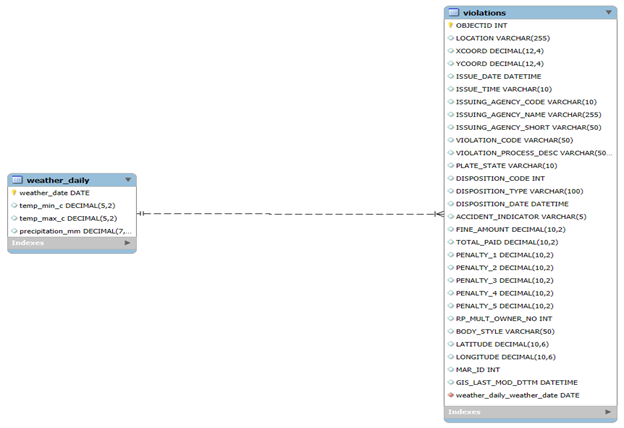

# DC Traffic Violations & Weather Analytics

**Python | Pandas | MySQL | SQLAlchemy | ETL | SQL**

## Overview

This graduate database/ETL project combines Washington, DC moving-violation records with daily weather observations to explore citation patterns, monetary fines, and differences between rainy and non-rainy days. The project includes a Python-based ingestion and cleaning workflow, MySQL table definitions, and SQL analysis queries.

## Highlights

- Downloaded monthly **DC Open Data** moving-violation files and daily weather information from the **Visual Crossing API**.
- Consolidated and deduplicated violation records using `OBJECTID`, standardized dates and numeric columns, and loaded data into MySQL using pandas and SQLAlchemy.
- The original project documentation reports **2,475,473 unique violation records** loaded into MySQL. This is a historical project run, not a live or independently reproduced count.
- Used SQL to analyze ticket volume by weekday and hour, issuing agencies, speeding-related fines, and rain-related trends.

## Data pipeline

`DC Open Data / Visual Crossing API` → `Python ETL + Pandas` → `CSV staging` → `MySQL (weather_daily, violations)` → `SQL analysis`

## Database model

The two tables are joined analytically on the **date** of a violation and the matching daily weather date. The current design is not a production-grade normalized data warehouse.

## Repository files

| File | Purpose |
|---|---|
| `Project2_ETL.ipynb` | ETL notebook; credential configuration sanitized for public sharing, original saved outputs removed |
| `Project2_ETL.py` | Python script generated from the sanitized notebook |
| `01_Create_Tables_HuynhNhatQuynh.sql` | MySQL database and table creation |
| `02_Analysis_Queries_HuynhNhatQuynh.sql` | Analytical SQL queries |
| `assets/database-erd.png` | ER diagram from the original project |
| `.env.example` | Example environment variables (no real secrets) |

## Setup (local)

1. Create a Python environment and run `pip install -r requirements.txt`.
2. Configure these **environment variables in your shell**, replacing placeholder values: `VISUAL_CROSSING_API_KEY`, `MYSQL_USER`, `MYSQL_PASSWORD`, `MYSQL_HOST`. Do not commit secrets to GitHub.
3. Install and start MySQL. Run `01_Create_Tables_HuynhNhatQuynh.sql` using MySQL Workbench.
4. Run the notebook sections in order: weather ETL → moving-violations ETL → MySQL load.
5. Run the SQL queries in `02_Analysis_Queries_HuynhNhatQuynh.sql`.

**Caution:** The extraction steps access external services and can take time or encounter rate limits. The table-creation SQL **drops existing tables**, and the load steps **truncate tables**. Use a disposable local database. Some original code assumes source files/columns are consistent over time; the public version has **not been fully rerun or validated** against current feeds.

## Public-data and credential notes

- Raw CSVs are intentionally excluded to keep the repository small. Source portals have their own usage terms; consult those before redistribution.
- This is a **public-safe code adaptation**, not a byte-for-byte copy of the submitted notebook. The original notebook contained embedded credentials; these were replaced with environment-variable references. Saved cell outputs and the original HTML export are excluded.
- Academic results, including the historical record count, come from the submitted project documentation.

## About

Completed for MIS 664A as part of graduate coursework at the University of Dayton. The project demonstrates ETL development, database design, SQL analytics, and working with public data sources.
